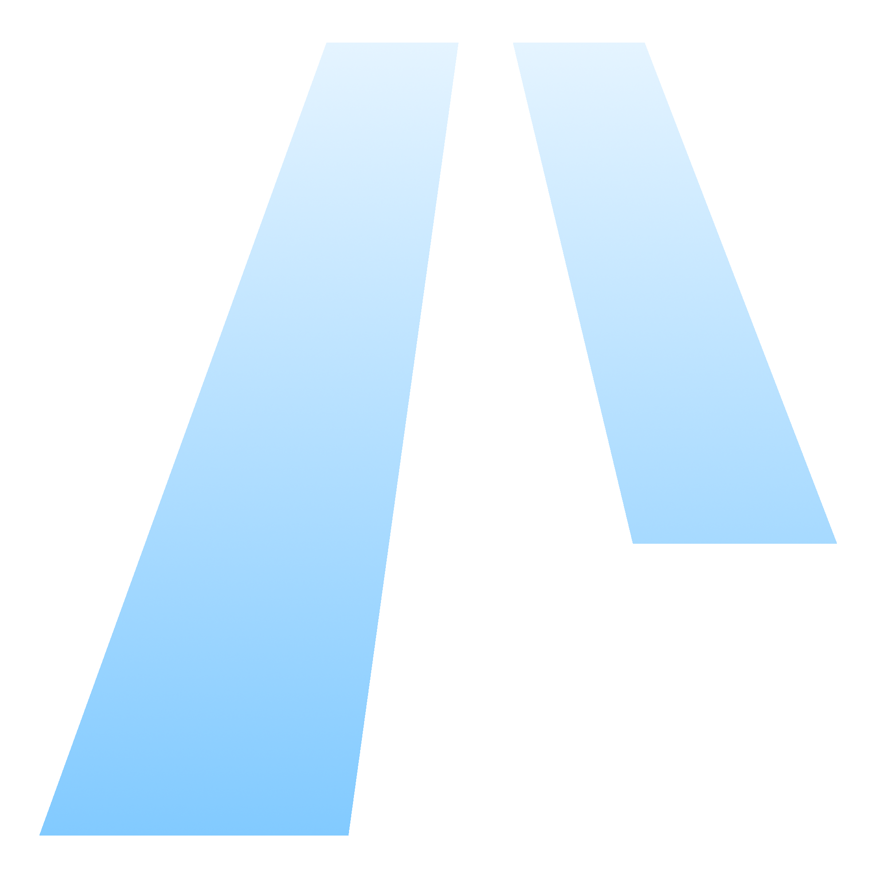
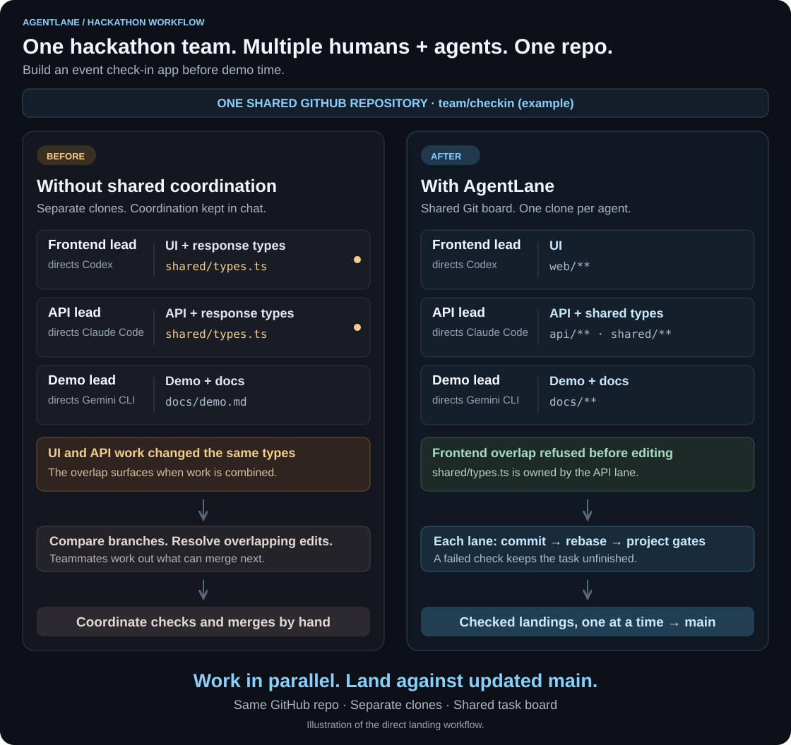

<div align="center">



# AgentLane

### Parallel coding agents. One repository. No collisions.

Give every agent a lane. Turn parallel work into a shared codebase.

[](https://github.com/thetrueshags/AgentLane/actions/workflows/contributions.yml)
[](pyproject.toml)
[](LICENSE)
[](CHANGELOG.md)

[Get started](#get-started) · [See the difference](#see-the-difference) · [How it works](#how-it-works) · [Contribute](CONTRIBUTING.md)

**Codex · Claude Code · Cursor · Gemini CLI · VS Code / Copilot · OpenCode · Shell**

</div>

---

Running more agents should mean more progress. AgentLane gives humans and coding agents a
shared task board, exclusive path claims, and isolated branches so they can work concurrently
on one project. When a lane is ready, AgentLane checks it and coordinates landing through Git.

**Your repo is the control plane.** The board lives in Git. No coordination server, database,
hosted service, or shared agent runtime is required. Python standard library only.

## See the difference

Your hackathon team is building an **event check-in app before demo time**. Three human
teammates direct coding agents: one builds the UI with Codex, another builds the API with
Claude Code, and a third prepares the demo and docs with Gemini CLI. Everyone works toward
the **same GitHub repository**, with a separate clone and unique identity for each agent.

Here is how the same team can work with and without shared coordination:

<picture>
  <source media="(max-width: 640px)" srcset="docs/assets/workflow-comparison-mobile.svg">
  
</picture>

**Parallel work, coordinated ownership.** Claims catch overlapping ownership before editing;
shared notes carry context between workers; project gates check each direct landing.
For example, the API worker can leave a note describing the response shape so the frontend
worker can build against it while the demo worker prepares the walkthrough.

## Why AgentLane?

| | What you get |
| :--- | :--- |
| **Space to work** | Each worker claims its paths before editing. Overlapping claims are refused. |
| **A shared picture** | Tasks, ownership, notes, and blockers travel with the repository. |
| **Checked landings** | Ownership checks, rebasing, and project gates run before direct landing. |
| **Your tools, together** | Different agents follow the same workflow through the CLI or MCP. |
| **Recovery built in** | Heartbeats and expiring claims let another worker recover abandoned work. |
| **A view for humans** | A local dashboard shows tasks, activity, and worker sessions in your browser. |

One person directing several agents. A team bringing different tools. A hackathon moving fast.
Each concurrent worker uses a **separate clone and unique name**. AgentLane coordinates
cooperative workers; repository permissions remain your responsibility.

## How it works

**Plan → Claim → Build → Check → Land**

Add tasks without reserving files. Take a task to claim its paths and get a branch. Work in your
lane, leave notes for the next worker, and commit. Then let `agentlane done` coordinate landing.

Each worker uses its own clone and claim branch. When workers finish, direct landings are
serialized; each runs against the updated shared codebase.
Follow the [three-worker walkthrough](docs/example.md) for the full flow.

## Get started

Requires Python 3.9+, Git and Bash (Git for Windows on Windows). There are no Python runtime
dependencies. Install from source:

```sh
git clone https://github.com/thetrueshags/AgentLane.git
cd AgentLane
python3 -m pip install -e .
agentlane --help
agentlane --version
```

Or use `pipx install .` for an isolated installation. For an existing project, install AgentLane
from a local source checkout or a maintainer-provided wheel, then work in that project.
No package has been published as part of this release preparation. On Windows, use `python` if
that selects your intended interpreter.

### Your first lane

In a project whose shared board is initialized, your agent can run:

```sh
git clone <project-repository>
cd <project-directory>
agentlane join --name alice --agent codex
agentlane status
agentlane list --available
agentlane take AL-12
# Work inside the claim's paths, then commit your changes.
agentlane note AL-12 "API complete; frontend can now use /auth/login"
agentlane sync
agentlane done AL-12
```

`take` without an ID lists available tasks. `show AL-12` shows description, paths, ownership,
branch, timestamps, stale state and notes. For incomplete setup, run `agentlane doctor`: it
diagnoses without making changes. Install the local pre-push guardrail with `agentlane install`;
`done` enforces its own checks regardless.

**Start with a conversation.** Tell your agent:

> Read AGENTS.md, inspect the board, and help me choose a task.

Setting up a new project? Follow [the one-time setup below](#set-up-a-project-once).
Contributing to AgentLane itself? Use [CONTRIBUTING.md](CONTRIBUTING.md); no board membership is needed.

## Follow the work

```sh
agentlane ui
```

Open **http://127.0.0.1:8787/** to follow tasks, claims, notes, approvals, activity, and worker
sessions. The dashboard is read-only, binds to loopback, and uses no external assets.
See the [localhost dashboard guide](docs/ui.md).

For optional foreground supervision in separate local clones:

```sh
agentlane worker run --clone ../worker --name engineer -- <command> <args...>
```

Local receipts and separate logs are available through `agentlane worker list`/`show` and
read-only MCP tools. This also works in ordinary Git source checkouts without a board.
Process exit never marks a task complete. See [local workers](docs/workers.md) for stdin files,
timeouts, duplicate protection and orphan recovery.

## Set up a project once

Start with a Git repository having an initial commit on its remote main branch. Defaults are
`main` and `board`.

```sh
agentlane install --project --agent codex
agentlane init
agentlane join --name alice --agent codex
```

`install --project` adds missing configuration, instructions, gates and the selected agent's MCP
configuration. Existing files are preserved; merge your existing instructions/configuration when
necessary. It refuses to replace a different pre-push hook and retains the MIT notice with copied
files. It does not create a remote or publish project files.

Commit generated files through a first setup lane, choosing the paths actually added:

```sh
agentlane take --new "Configure project coordination" --paths ".harness/**" "AGENTS.md" ".codex/config.toml"
git add .harness AGENTS.md .codex/config.toml
git commit -m "Configure AgentLane"
agentlane done
```

Customize `.harness/gate/code.sh` before this landing. `agentlane doctor` explains remaining setup
steps. For source contributions to AgentLane itself, use [CONTRIBUTING.md](CONTRIBUTING.md) instead.

## Plan, work and recover

```sh
agentlane add "Implement auth endpoint" --description "Return a tested login response" \
  --paths "src/auth/**" "tests/auth/**"
agentlane list --mine
agentlane show AL-12
agentlane heartbeat
agentlane sync
agentlane release AL-12
```

Backlog tasks reserve no paths. Conflicting claims are refused, including simultaneous attempts.
Paths are repository-relative; quote wildcards. See [glob semantics](docs/architecture.md#path-ownership).

Claims default to 45 minutes with two extensions, and become recoverable after 15 minutes without
a heartbeat. Send heartbeats while working; reads do not refresh claims. Timing is configurable.
Stale claims stay visible until a sweep or new take releases them. Re-taking recovers an existing
branch when available. `release --force AL-12` recovers only stale ownership, never a live claim.
Branches preserve commits; push them so another clone can recover the work.

## Landing and gates

`done` verifies ownership, rebases onto current main, checks paths, runs the project gate, and
rechecks the lease. It publishes code and task completion in **one atomic Git push**. If another
worker lands first, AgentLane refreshes, rebases and checks again. A failing gate, expired lease
or rejected ref update does not mark work complete. Direct landing requires a remote supporting
atomic pushes; there is no unsafe fallback.

`.harness/gate/code.sh` defines acceptable work. The sample detects Python, Node package managers,
Go, Rust, Elixir, Ruby/Rails and Java. Documentation paths use `.harness/gate/docs.sh`. Missing gates fail
closed. See [gate customization](docs/gates.md).

For GitHub review, set `landing_mode` to `pr` in `.harness/config.json`, or use `done --pr`.
Successful submission releases ownership into review; after merging or closing, run
`agentlane sync --reviews`. GitHub CLI/authentication are needed for PR operations and opt-in GitHub identity mode.
PR submission is not completion. Core direct landing works with a writable Git remote.

Target main's committed `landing_mode` enforces PR-only landing even if a candidate changes its
local configuration. Set `pr_draft` to `false` when required reviewer workflows need ready PRs.
Use `add --ref TEAM-123` to connect a task to a tracker ticket. Optional `identity_mode: "github"`
binds members to their authenticated GitHub login. `agentlane export --out ./evidence` bundles
committed board history and gate evidence; see [architecture](docs/architecture.md).

For independent review before **direct** landing, opt in with `"require_review": true`.
The policy is read from exact target main and takes effect after the enabling change lands.
A registered reviewer who has never owned implementation tests the pushed commit in a separate
clean checkout and records `approve TASK --commit FULL_SHA --base FULL_SHA --evidence TEXT`.
Engineering keeps the claim and runs `done`; changed commits, bases or leases need fresh approval.
PR mode is incompatible with this policy. See the [review workflow](docs/example.md#optional-independent-review).

## Integrations and optional automation

Claude Code, Codex, Cursor, Gemini CLI, VS Code/Copilot, OpenCode and shell agents all follow
[AGENTS.md](AGENTS.md). CLI and MCP share one engine. Source checkouts retain `tools/board-mcp`
and existing configurations; installed projects can launch `agentlane mcp`.
See [integration details](docs/integrations.md).

GitHub Actions and Slack are optional. Workflows can check landed work, recover failed landings
when a board is present, and expire stale claims. They target `main`/`board`; adapt them for custom
branch names. Automated writes require `AGENTLANE_AUTOMATION_TOKEN`,
`AGENTLANE_AUTOMATION_MEMBER` and [repository protection rules](docs/architecture.md#restricted-automation-credentials).
Set `SLACK_WEBHOOK_URL` for concise notices. Core commands need neither GitHub Actions nor Slack,
and can use a local bare Git remote.

## Build with us

Help make parallel agent work easier to coordinate. Bring a bug report, a clearer setup step,
an integration, or feedback from a real project. Source contributors use ordinary branches
and PRs without board membership.

[**Contribute**](CONTRIBUTING.md) · [Report a bug](https://github.com/thetrueshags/AgentLane/issues/new/choose) · [Share an idea](https://github.com/thetrueshags/AgentLane/discussions)

If AgentLane fits how you want to build, **give it a star** so you can find it again and help
others discover it.

## Go deeper

- [CLI and workflow reference](docs/agentlane.md)
- [Architecture and recovery](docs/architecture.md)
- [Agent integrations and MCP](docs/integrations.md)
- [Project gates](docs/gates.md)
- [Localhost dashboard](docs/ui.md)
- [Local worker supervision](docs/workers.md)
- [Three-worker example](docs/example.md)
- [Changelog](CHANGELOG.md) and [release instructions](docs/releasing.md)
- [Community guidelines](CODE_OF_CONDUCT.md) and [private security reporting](SECURITY.md)

Run `python3 -m unittest discover -v` for the complete credential-free suite. Build instructions
live in CONTRIBUTING.md. AgentLane is [MIT licensed](LICENSE).
